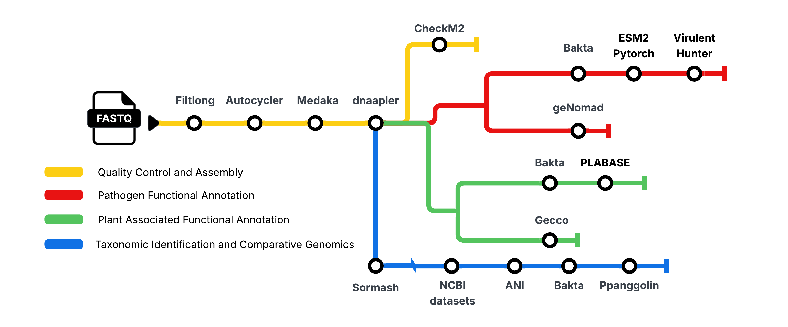

<p align="center">
  
</p>

# PanFrame

**PanFrame** is a scalable Nextflow workflow designed for analyzing bacterial genomes within a pangenomic framework—ranging from pathogen virulomes to plant growth-promoting traits (PGPT).

---

## Computational Architecture

The workflow automates processing from raw long-read assembly to pangenome reconstruction across core, shell, and cloud partitions.

<p align="center">
  
</p>

### Main Pipeline Branches
* **Quality Control & Assembly:** Filtlong, Autocycler, Medaka, dnaapler
* **Pathogen Functional Annotation:** CheckM2, Bakta, ESM2 (PyTorch), Virulent Hunter, geNomad
* **Plant-Associated Functional Annotation:** Bakta, PLABASE, Gecco
* **Taxonomic Identification & Comparative Genomics:** Sourmash, NCBI Datasets, ANI, Bakta, PPanGGOLIN

---

## How to Use

Run the pipeline using Nextflow with the following command:

```bash
nextflow run cjtejada/Panframe \
  -profile docker,process_medium \
  -input reads.fastq.gz \
  -mode pathogen \
  -output_dir ./results
